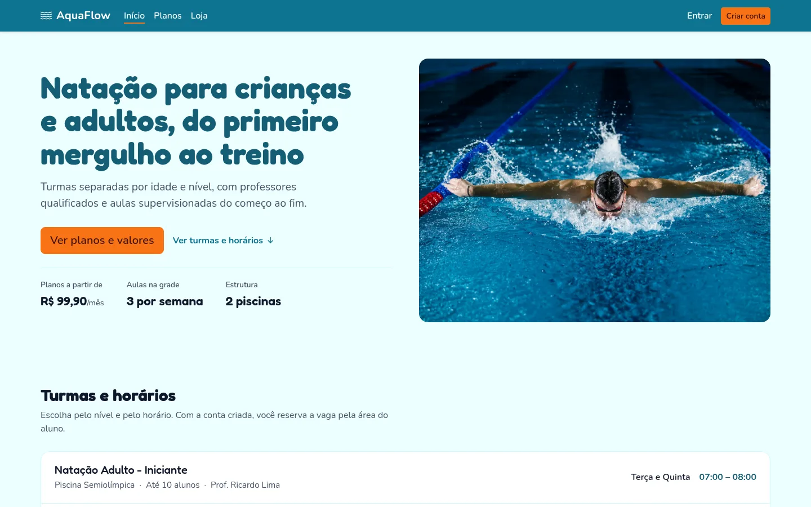
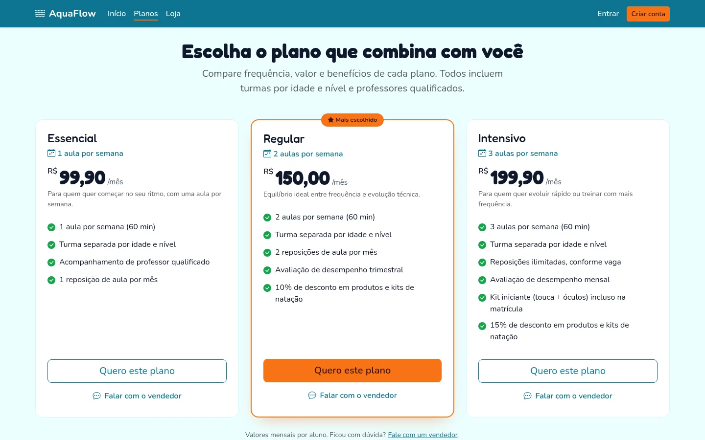
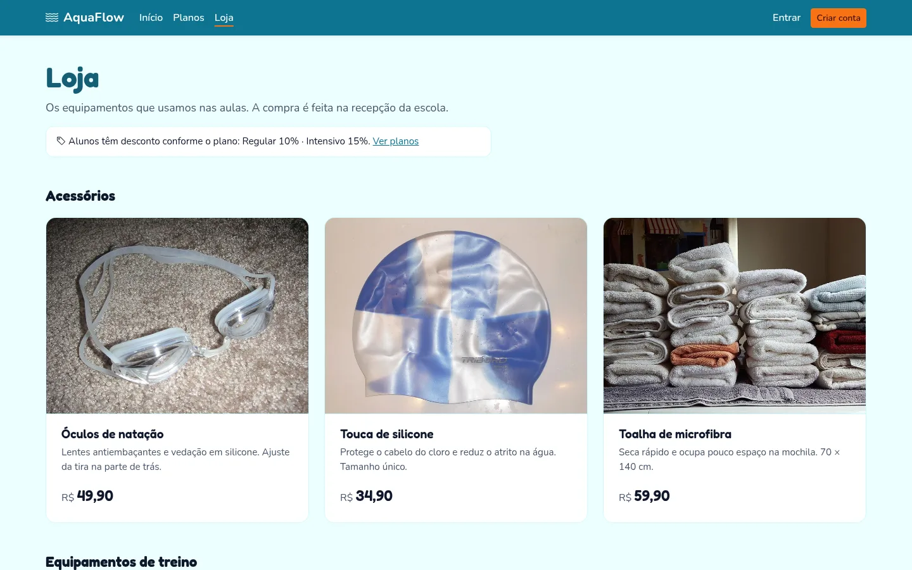

# AquaFlow

[](https://github.com/Vinii225/aquaflow/actions/workflows/ci.yml)
[](https://github.com/Vinii225/aquaflow/actions/workflows/deploy.yml)


Sistema de gestão para escola de natação: página institucional, planos mensais, loja, piscinas, turmas, grade de horários, reservas de alunos, chamada de presença e financeiro.

**Homologação:** https://aquaflow-9h8a.onrender.com

> O plano gratuito do Render hiberna o serviço quando fica sem acesso. O primeiro carregamento pode levar até 1 minuto.



| Planos mensais | Loja |
| --- | --- |
|  |  |

## Funcionalidades

**Público**
- Página inicial: turmas e horários, resumo dos planos, professores, piscinas e contato (tudo vindo do banco)
- Planos mensais (`/planos`) lado a lado, com plano em destaque e "Falar com o vendedor"
- Loja (`/loja`): catálogo de equipamentos por categoria, com o desconto de aluno de cada plano
- Cadastro e login de aluno

**Por papel**

| Papel | O que faz |
| --- | --- |
| Administrador da escola | Piscinas, turmas, grade, geração de aulas, assinaturas, faturas, caixa e usuários |
| Professor | Vê suas aulas e faz a chamada |
| Aluno | Reserva vagas, acompanha reservas e faturas |
| Equipe AquaFlow (plataforma) | Caixa de entrada das mensagens de contato e encaminhamento para a escola |

## Stack

Java 17 · Spring Boot 3.3 · Spring Security · Thymeleaf · Bootstrap 5 · PostgreSQL 16 · Flyway · Docker · GitHub Actions · Render

## Como rodar

### Com Docker (recomendado)

```bash
docker compose up -d --build
```

Abre em http://localhost:8080. O Flyway cria o schema e os dados de demonstração na primeira subida.

```bash
docker compose down      # para tudo
docker compose down -v   # para e apaga o banco
```

As portas podem ser trocadas com `APP_PORT` e `DB_PORT` (ex.: `APP_PORT=9090 docker compose up -d`).

### Sem Docker

Pré-requisitos: JDK 17 e um PostgreSQL acessível.

```bash
cp .env.example .env   # ajuste as credenciais do banco
./mvnw spring-boot:run
```

### Variáveis de ambiente

| Variável | Padrão | Uso |
| --- | --- | --- |
| `DB_HOST` / `DB_PORT` / `DB_NAME` | `localhost` / `5432` / `aquaflow` | Conexão com o PostgreSQL |
| `DB_USER` / `DB_PASSWORD` | `aquaflow` / `aquaflow` | Credenciais do banco |
| `PORT` | `8080` | Porta HTTP (o Render define sozinho) |
| `FLYWAY_ENABLED` | `true` | Roda as migrations ao subir |
| `FLYWAY_BASELINE_VERSION` | `2` | Versão assumida para um banco já populado sem histórico do Flyway |
| `SHOW_SQL` | `false` | Loga as queries do Hibernate |
| `THYMELEAF_CACHE` | `false` | Use `true` em produção |

## Login de demonstração

| Papel | E-mail | Senha |
| --- | --- | --- |
| Administrador | admin@aquaflow.com | admin123 |
| Professor | ricardo@aquaflow.com | professor123 |
| Aluno | aluno@aquaflow.com | aluno123 |
| Equipe AquaFlow | plataforma@aquaflow.com | plataforma123 |

Também dá para criar uma conta de aluno em `/register`.

### Roteiro rápido de teste

1. Admin → **Aulas** → "Gerar próximas semanas" (cria as aulas a partir da grade).
2. Aluno → **Aulas disponíveis** → reservar uma vaga.
3. Professor → **Minhas aulas** → "Fazer chamada".
4. Admin → **Faturas** → gerar as faturas do mês e registrar um pagamento.
5. Visitante → **Planos** → "Falar com o vendedor"; depois, como Equipe AquaFlow → **Mensagens**.

## Testes

```bash
./mvnw verify
```

Os testes sobem a aplicação inteira contra um PostgreSQL real com [Testcontainers](https://testcontainers.com/) (precisa de Docker rodando) e rodam todas as migrations. Eles verificam as páginas públicas (home, planos e loja com dados do banco), a proteção das áreas restritas e o login. Há também testes unitários para a lógica de tela que não depende do banco.

## CI/CD

| Workflow | Quando roda | O que faz |
| --- | --- | --- |
| [`ci.yml`](.github/workflows/ci.yml) | Push na `main` e todo pull request | Build, testes e build da imagem Docker |
| [`deploy.yml`](.github/workflows/deploy.yml) | Depois do CI verde na `main` (ou manual) | Dispara o deploy no Render (se houver `RENDER_DEPLOY_HOOK_URL`) e faz smoke test em homologação |

O Dependabot abre PRs mensais para dependências Maven, actions e imagens Docker.

### Deploy no Render

O serviço é um **Web Service Docker** apontando para a branch `main` e usando o `Dockerfile` da raiz. Configure as variáveis `DB_*` com os dados do PostgreSQL do Render e `THYMELEAF_CACHE=true`.

Para o GitHub disparar o deploy só depois do CI, copie o **Deploy Hook** do serviço (Settings → Deploy Hook), salve como segredo `RENDER_DEPLOY_HOOK_URL` no repositório e desligue o auto-deploy do Render (ou use "After CI checks pass").

**Sobre o banco de homologação:** o banco do Render foi criado manualmente com as migrations V1 e V2, sem a tabela de histórico do Flyway. Com `baseline-on-migrate`, o Flyway marca esse banco como versão 2 na primeira subida e aplica só as migrations novas (V3, V4, ...). Em um banco vazio, ele roda tudo do zero.

## Estrutura

```
src/main/java/br/edu/aquaflow/
  config/        Spring Security e configurações tipadas (AquaflowProperties)
  domain/        entidades JPA e enums
  repository/    Spring Data JPA
  security/      autenticação e papéis
  service/       regras de negócio (agenda, reserva, chamada, financeiro, contato)
    site/        montagem das telas públicas (home e loja)
  web/           controllers (público, admin, professor, aluno, plataforma)
src/main/resources/
  db/migration/  Flyway (schema, dados de demonstração, planos, mensagens, produtos)
  templates/     Thymeleaf (fragments/ tem head, navbar, footer e alerts)
  static/        CSS e imagens
src/test/        testes de integração (Testcontainers) e unitários
.github/         CI/CD, Dependabot e template de PR
docs/            arquitetura, créditos das imagens e prints
```

Antes de mexer no código, leia [docs/ARQUITETURA.md](docs/ARQUITETURA.md) (camadas, onde fica cada coisa, regras de migration) e [CONTRIBUTING.md](CONTRIBUTING.md) (branches, commits e PRs).

## Equipe

Planejamento e sprints no [Trello](https://trello.com/b/EetgQnZH/aquaflow-projeto-gps).

| Integrante | Papel |
| --- | --- |
| Vinícius Ares | Product Owner · deploy |
| Emanoel Barreto | Scrum Master (Sprint 3) · catálogo de produtos |
| Igor Andrade | Desenvolvimento · planos mensais |
| Luis Eduardo | Desenvolvimento · banco de dados |
| Ramotep Lopes | Desenvolvimento · planos de gerenciamento |

## Roadmap

- [x] MVP: página institucional, agenda, reservas, chamada e financeiro
- [x] Planos mensais (PB-01)
- [x] Catálogo de produtos de natação: listagem (PB-03)
- [ ] Busca e filtro no catálogo (PB-03)
- [ ] Contratação de plano com pagamento online (PB-02)
- [ ] Carrinho e checkout (PB-04)

## Créditos

Fotos dos produtos: Wikimedia Commons. Autores e licenças em [docs/CREDITOS.md](docs/CREDITOS.md).
